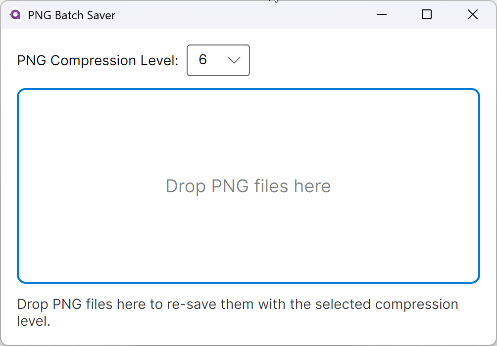

# PNG Batch Saver

Drag one or more PNG files onto the window, pick a compression level (0–9), and the files are re-encoded in-place. Built based on Avalonia + ReactiveUI.

# Build and run the application

Make sure .NET 8 SDK is installed. Run the command:

```shell
dotnet run --project PNGBatchSaver.Desktop
```

